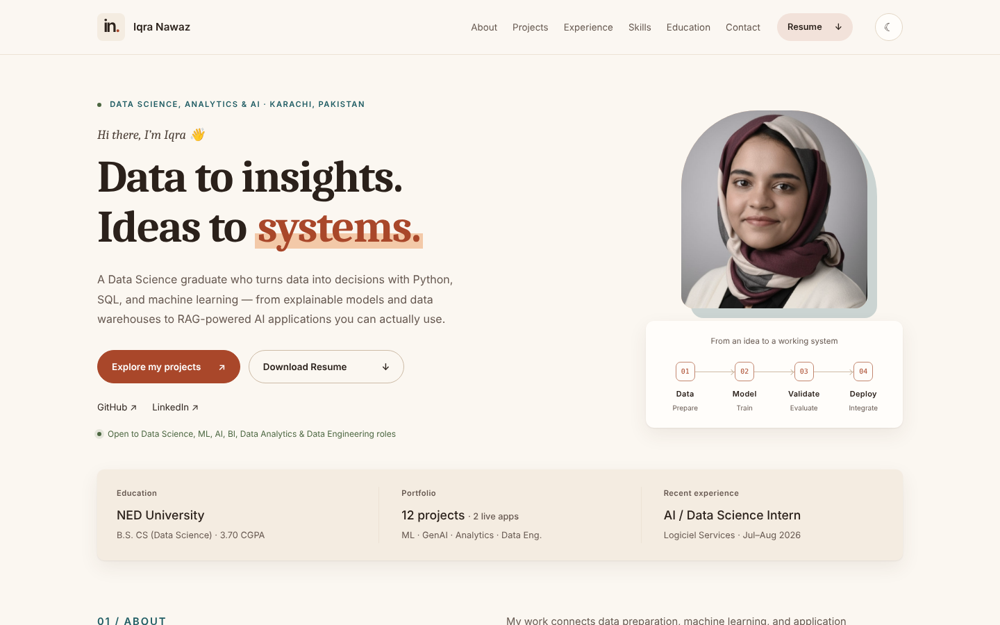
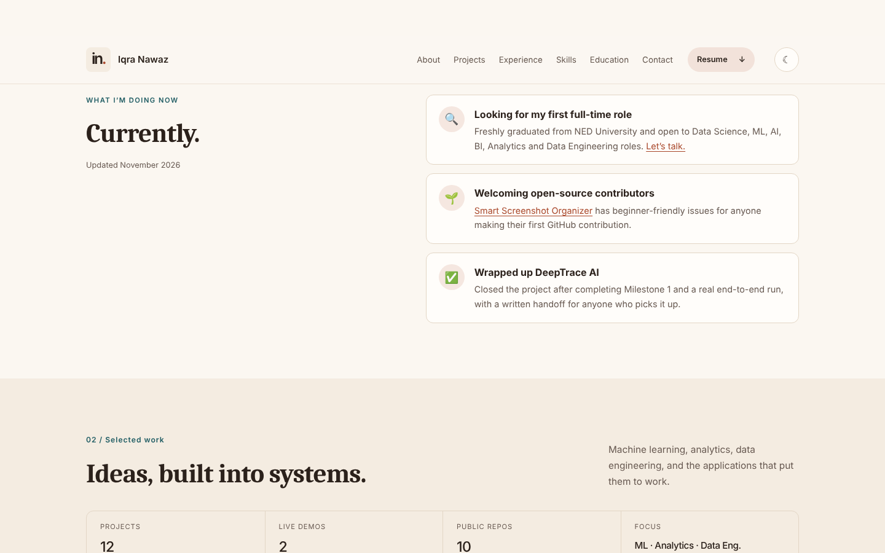
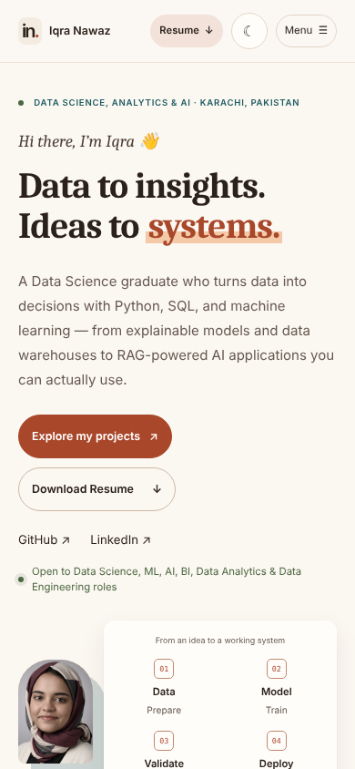
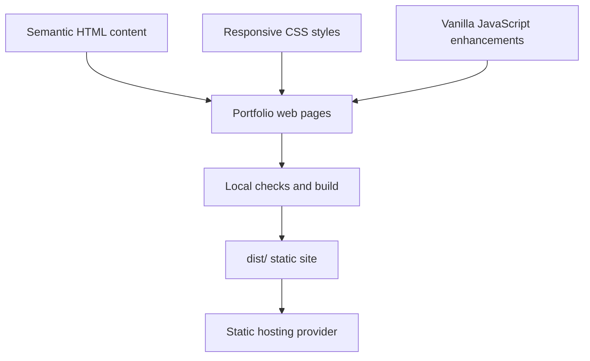

<div align="center">

# ✨ Iqra Nawaz | Developer Portfolio

### A little about me, a lot about what I love to build.

**A fast, responsive, thoughtfully crafted portfolio — made with HTML, CSS & JavaScript.**


### 🌐 [View the live portfolio](https://iqranawaz-debug.github.io/portfolio/)

**[Featured projects](#-featured-projects) · [Run locally](#-quick-start) · [How it works](#-project-structure)**

</div>

---

## 👋 Hello, world!

Welcome to my personal corner of the web! This portfolio brings together my projects, technical skills, experience, education, and learning journey in one place.

I wanted it to feel **clean, easy to explore, and personal** — without sacrificing accessibility or performance. So I built it with the web's fundamentals: **semantic HTML, modern CSS, and vanilla JavaScript**.

> **The idea:** Let the work tell the story — no unnecessary frameworks, heavy bundles, or complicated setup.

## 🌟 Highlights

| ✨ Feature | 💡 What it offers |
|---|---|
| **Responsive layout** | Designed for mobile, tablet, and desktop screens |
| **Project case studies** | Expandable project details with native HTML `<details>` |
| **Skills & experience** | A clear overview of tools, work, and learning |
| **Education & certifications** | Dedicated sections for academic and professional growth |
| **Resume access** | Downloadable PDF resume from the navbar and hero section |
| **Accessible by design** | Semantic content available even with JavaScript disabled |
| **Smooth navigation** | Responsive menu and active-section highlighting |
| **Lightweight build** | No framework, CDN, external fonts, or production dependencies |
| **Privacy-friendly** | No analytics, API keys, or backend data collection |
| **Reduced-motion support** | Respects visitors' motion preferences |
| **Warm light & dark themes** | Cream-and-terracotta palette with a warm dark mode; follows the system setting, with a toggle that remembers the visitor's choice |
| **"Now" & principles** | A /now-style update on current focus, plus the data-work principles behind the projects |

## 🖼️ Sneak peek



| Projects section | Mobile |
|---|---|
|  |  |

## 📂 Featured projects

| Project | Area | Highlights | Links |
|---|---|---|---|
| **DeepTrace AI** | GenAI · RAG | Agentic research workspace; citations checked by code — 9/9 quotes matched, 2 bad citations caught in first live run | [Code](https://github.com/Iqranawaz-debug/DeepTrace-AI) |
| **Bank Marketing Intelligence** | ML · Analytics | Leakage-aware, explainable ML with threshold analysis and batch scoring | [Live demo](https://bank-marketing-intelligence-carun64aee6xuak9rj2vmj.streamlit.app/) · [Code](https://github.com/Iqranawaz-debug/Bank-Marketing-Intelligence) |
| **ResumeIQ** | NLP · Full-stack | Explainable resume–job matching with React + FastAPI, grounded AI rewrites | [Code](https://github.com/Iqranawaz-debug/ResumeIQ) |
| **SQL Data Warehouse** | Data Engineering · BI | SQL Server Medallion architecture (Bronze → Silver → Gold), star schema, data quality checks | [Code](https://github.com/Iqranawaz-debug/SQL_DATAWAREHOUSE_PROJECT) |
| **SentixAI** | NLP | ~92% accuracy on 1,000+ product reviews | [Code](https://github.com/Iqranawaz-debug/Sentiment_Analysis_On_Product_Reviews) |
| **LeafGuard AI** | Computer Vision | CNN plant-disease classifier + OpenAI care guidance | [Code](https://github.com/Iqranawaz-debug/LeafGuard-AI) |
| **CineMatch** | Recommender | Content-based movie recommendations with TMDB metadata | [Live demo](https://iqra-movie-recommender.streamlit.app/) · [Code](https://github.com/Iqranawaz-debug/Movie-Recommender-Sys-app) |
| **Smart Screenshot Organizer** | OCR · Automation | Local Tesseract OCR, rule-based categorisation, SQLite search | [Code](https://github.com/Iqranawaz-debug/Screenshot_Organizer) |
| **RouteWise** | AI Search | Dijkstra vs A* route finding to NED University | [Code](https://github.com/Iqranawaz-debug/NED-Route-Finder) |
| **Shopify Product API** | Backend | Express, JWT auth, SQLite CRUD, Shopify GraphQL Admin API | [Code](https://github.com/Iqranawaz-debug/nodejs-shopify-product-management) |

Also on the site: the **Automated Data Pipeline** (final year project) and the **AI-Based Medicine Recommendation System** (in development).

## 🧭 What you'll find

- **About** — Who I am, what motivates me, and the principles I bring to data work.
- **Now** — What I'm focused on at the moment.
- **Projects** — A project overview strip, four featured case studies (problem → approach → implementation → result), and a filterable grid of more projects with live-demo and source links.
- **Experience** — Logiciel Services, Arch Technologies, NED University and KDA.
- **Education** — My academic background.
- **Certifications** — Professional certificates plus additional courses (IBM, DeepLearning.AI, DataCamp).
- **Contact** — Ways to connect; email links open the visitor's own mail app.

The project's content reflects the profile and portfolio materials supplied during development. **Projects and demos aren't presented as deployed unless a verified link exists.**

## 🛠️ Built with

| Technology | Role |
|---|---|
| **HTML5** | Semantic structure and accessible content |
| **CSS3** | Styling, responsive layouts, transitions, and design tokens |
| **Vanilla JavaScript** | Mobile navigation, active-section behavior, project filters, and dynamic year |
| **Node.js 18+** | Local checks, build, and preview scripts — **not** a site runtime dependency |
| **Playwright (optional)** | Browser regression testing |

### 💡 Why no frontend framework?

This is a deliberately small static site. Vanilla web technologies keep it straightforward to host, inspect, and maintain. The important content remains readable without JavaScript.

## 🚀 Quick start

You'll need **Node.js 18 or newer** for the provided development scripts. No npm packages need to be installed.

```bash
# Verify project structure and assets
npm run check

# Run automated checks
npm test

# Build the static site
npm run build

# Preview the production output
npm start
```

Open **http://127.0.0.1:4173** to see the local production preview.

> The website itself is static. The Node scripts are development and build utilities, not a required backend server in production.

## 🗂️ Project structure

```text
portfolio/
├── index.html                    # Content, sections, case studies & metadata
├── style.css                     # Design tokens and responsive styling
├── script.js                     # Navigation and small UI enhancements
├── assets/
│   ├── favicon.svg               # Portfolio favicon
│   ├── images/                   # Project images
│   ├── screenshots/              # README previews
│   └── Iqra-Nawaz-Resume.pdf     # Downloadable resume
├── sitemap.xml / robots.txt      # SEO for the GitHub Pages URL
├── tools/                         # Dependency-free build and preview scripts
├── tests/                         # Automated project checks
├── package.json                   # Development commands
└── dist/                          # Generated static deployment output
```

`dist/` is generated by the build. It contains the public files needed for deployment; unrelated source images and certificates remain untouched in the source repository.

## 🧩 How it works



- **HTML** holds the actual content, including the project case studies.
- **CSS** handles the visual design, breakpoints, reduced-motion styles, and printing.
- **JavaScript** enhances navigation without being required to read the core content.
- **Build scripts** prepare only referenced public assets for static hosting.

## 📱 Responsive and accessible

The layout includes breakpoints at **640px, 900px, 1100px, and 1500px**. Desktop navigation stays visible above 900px; smaller screens use a collapsible menu.

Project case studies use native `<details>` elements. Where supported, CSS adds progressive transitions, with an immediate alternative when a visitor prefers reduced motion. The site also includes print styling.

## 🧪 Testing and quality checks

```bash
npm run check
npm test
npm run build
```

The automated checks cover areas including **navigation, referenced assets, contact/privacy behavior, and factual content**.

For optional browser-level regression tests, install Playwright separately, start the preview with `npm start`, then run (set `BROWSER_CHANNEL=msedge` or `chrome` to use a branded browser instead of bundled Chromium):

```bash
npm run test:browser
```

If Playwright is installed outside the project, `PLAYWRIGHT_MODULE` can point to its module path. Headless browser test screenshots are saved under ignored `test-results/`. **Playwright is only for testing, not a website dependency.**

## 🌍 Deployment

Run:

```bash
npm run build
```

Deploy the **contents of `dist/`** to your preferred static hosting service. Since the site uses relative asset paths, it can also work under a repository subdirectory.

The site is published with GitHub Pages at **https://iqranawaz-debug.github.io/portfolio/**. The canonical URL, Open Graph URL/image, JSON-LD `Person` data, `sitemap.xml` and `robots.txt` all point there — update them if you move to a custom domain.

**Note:** The local preview server is intended for development, not as a public production server.

## ✏️ Customizing the portfolio

| File or folder | Update this when you want to… |
|---|---|
| `index.html` | Edit your introduction, projects, experience, education, certifications, or contact links |
| `style.css` | Change colors (all palette tokens live in `:root` and the dark-theme blocks at the top), spacing, responsive styles, and animations |
| `script.js` | Adjust navigation enhancements |
| `assets/` | Update your resume, favicon, or referenced images |
| `tests/` | Maintain regression checks after changing content or navigation |

Your resume download currently points to `assets/Iqra-Nawaz-Resume.pdf`. Contact links open an email application; **there is no contact-form backend**.

## 🔍 Content integrity and honest project showcases

A portfolio should be attractive **and** accurate. This site avoids invented metrics or unsupported deployment claims.

- The medicine-related project is described as **in development**.
- The supplied sentiment-analysis result is presented as approximately **92% on 1,000+ reviews**, without inventing an evaluation protocol.
- The FYP image caption identifies it as an interface preview, not as performance evidence.
- Missing or empty repositories are not presented as working public demos.
- Certificate files remain in source, but unverified certificates are not linked as evidence.
- No contact analytics or user-data collection is implemented.

## 🧭 What's next?

Ideas for future improvements:

- [x] Add real desktop and mobile preview screenshots.
- [x] Add verified live demo links for deployed projects.
- [x] Configure production SEO metadata and a sitemap.
- [ ] Add screenshots or short demo GIFs for each featured project.
- [ ] Deploy ResumeIQ and DeepTrace AI demos (mock mode) for recruiters to try.
- [ ] Add a short blog / write-ups section explaining project decisions.
- [ ] Explore further accessibility and performance audits.

## 🤝 Let's connect

I'm always interested in learning new technologies, improving my work, and connecting with people who enjoy building things.

**Find my contact and profile links directly on the portfolio website.**

---

<div align="center">

### Built with ❤️ and dedication

**Made by Iqra Nawaz**

*Every project is another opportunity to learn something new.* ✨

</div>
