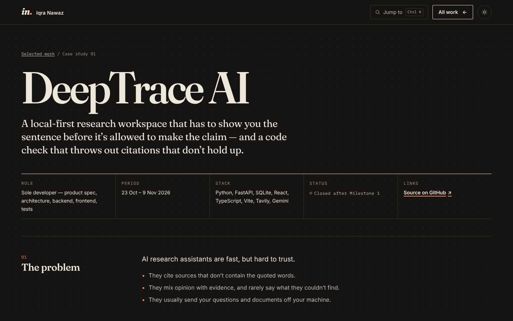

# Iqra Nawaz — portfolio

**I build AI that shows its work.** Data science and applied AI portfolio: evidence-checked research tools, explainable scoring, honest predictive models and the data pipelines underneath.

**Live site:** https://iqranawaz-debug.github.io/portfolio/


| Selected work | Mobile | Case study, dark theme |
|---|---|---|
|  |  |  |

## The idea

An editor's proof sheet: warm paper, deep ink and one red pen. Projects are presented the way a careful researcher presents results, with the evidence, the decisions and the limitations next to the claim. The toolkit cites its sources with superscript links to the projects where each skill was used. The section index `IN·01 … IN·07` and the italic *in.* monogram are the recurring identity device.

## What's on the site

| Page | Contents |
|---|---|
| `index.html` | Hero and lab notes · three flagship case studies (DeepTrace AI, ResumeIQ, Bank Marketing Intelligence) · Screenshot Organizer field note · filterable archive · about and principles · experience · toolkit · education · contact |
| `work/deeptrace-ai.html` | Case study: problem, contribution, architecture and decisions, verification, limitations |
| `work/resumeiq.html` | Case study, including the collaboration with Arisha Salman |
| `work/bank-marketing-intelligence.html` | Case study with held-out metrics and the leakage decisions |
| `404.html` | Styled not-found page that works at any URL depth on GitHub Pages |

Every number on the site comes from the project's own repository: closure reports, phase reports, test files or the deployed app's evaluation pages.

## Interactive details

- **Ctrl/Cmd+K command palette** (or the "Jump to" button) to reach any section, project or case study.
- **Live citation check** in the hero: a real quotation-matching check on sentences from the DeepTrace README.
- **Archive filters** (All, ML, LLM, Data Eng, Apps), copy-to-clipboard email, and a remembered light/dark theme.
- All motion respects `prefers-reduced-motion`; everything works without JavaScript.

## Filling in missing content

Unfinished content lives in hidden slots marked `TODO(iqra)`. Open the site with `?draft` at the end of the
URL to see them outlined; the full list is in [`TODO.md`](TODO.md).

## Design system

All tokens live at the top of `style.css`.

- **Colour:** paper `#f3eee4`, ink `#1a1916` and one red pen `#b3351a`, plus a warm dark theme that follows the system setting, with a toggle that remembers the visitor's choice. Text contrast meets WCAG AA in both themes.
- **Type:** Fraunces (display, variable, self-hosted) · system UI sans (text) · IBM Plex Mono (labels and indexes). The fonts are subset to Latin and served from `assets/fonts/` under the SIL Open Font License, so there are no third-party requests.
- **Layout:** a 12-column grid, fine rules instead of boxes, square-cornered buttons, editorial numbering.
- **Motion:** one quiet reveal and the red underline drawing itself. Both are switched off under `prefers-reduced-motion`.

## Run it locally

Requires Node.js 18 or newer. There are no npm dependencies.

```bash
npm run check
```

```bash
npm test
```

```bash
npm run build
```

```bash
npm start
```

Then open http://127.0.0.1:4173. Browser regression tests need Playwright installed separately and the preview running:

```bash
npm run test:browser
```

Set `BROWSER_CHANNEL=msedge` (or `chrome`) to use a branded browser instead of bundled Chromium.

## Project structure

```text
portfolio/
├── index.html, 404.html          # Home page and not-found page
├── work/                         # Case-study pages
├── style.css                     # Design tokens and all styles (sectioned)
├── script.js                     # Menu, active section, filter, theme, previews
├── assets/
│   ├── fonts/                    # Self-hosted, subset WOFF2 + licence
│   ├── work/                     # Project screenshots (WebP)
│   ├── images/                   # Portrait, FYP screenshot
│   ├── og-card.png               # 1200×630 social preview
│   └── Iqra-Nawaz-Resume.pdf
├── tools/site-files.mjs          # The one list of public files
├── tools/build.mjs, serve.mjs    # Build to dist/ and local preview
└── tests/                        # Content/link tests and browser tests
```

When you add a page or asset, add it to `tools/site-files.mjs`. The tests fail if a page links to a file that isn't listed there.

## Deploying to GitHub Pages

The site is served straight from the repository root of the `main` branch.

1. Merge changes into `main`.
2. In the repository's **Settings → Pages**, the source should be **Deploy from a branch**, branch `main`, folder `/ (root)`.
3. Wait for the "pages build and deployment" workflow to finish (about a minute), then hard-refresh the site.

`npm run build` also produces a clean `dist/` folder for any other static host.

## Notes

- The resume download is `assets/Iqra-Nawaz-Resume.pdf`.
- There is no contact-form backend, analytics or tracking; email links open the visitor's mail app.
- `.claude/skills/ui-ux-pro-max/` is a vendored, MIT-licensed design skill for Claude Code. It isn't part of the site.

Built with love and dedication by Iqra Nawaz.
